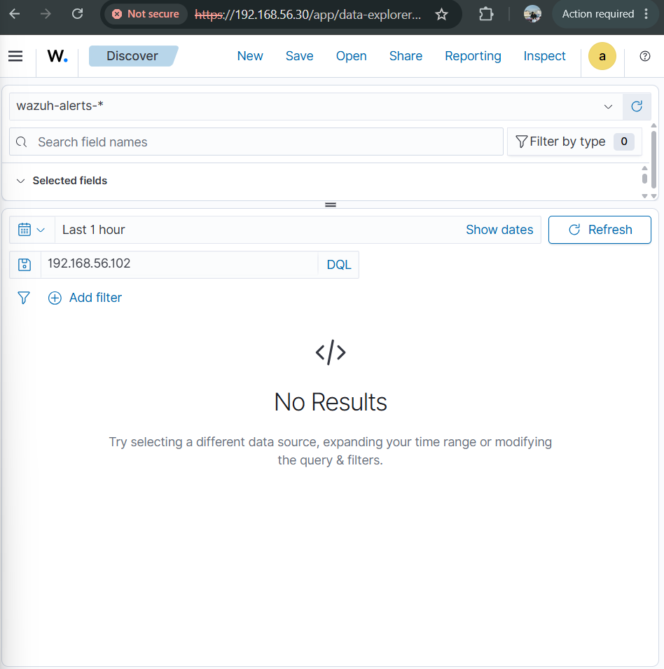
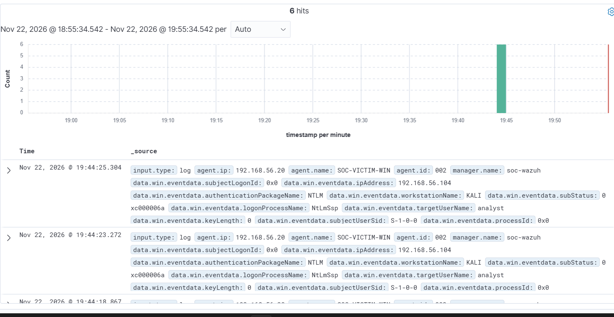
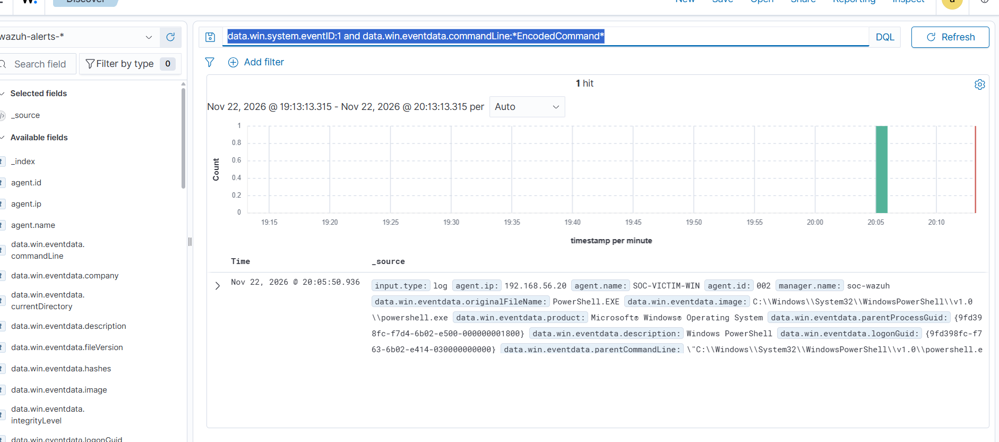
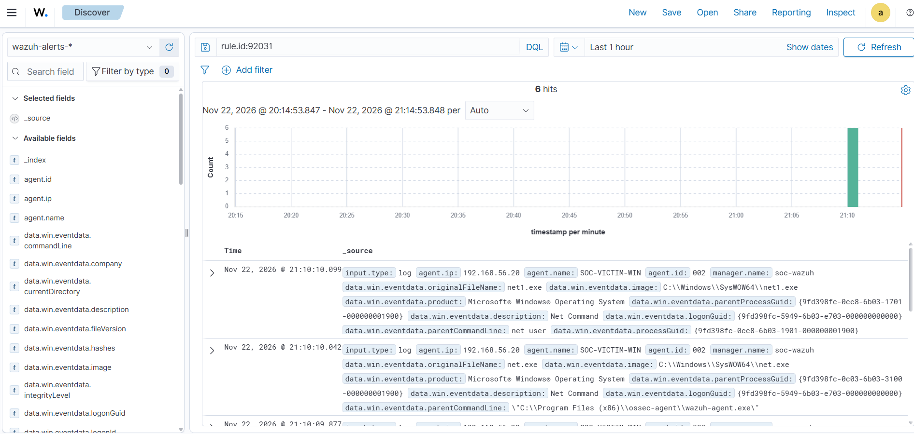

# THREAT DETECTION IN A WINDOWS DOMAIN USING THE WAZUH SIEM

**A home SOC lab: deploying Wazuh and detecting MITRE ATT&CK techniques on monitored endpoints**

---

Prepared by: **Gokul Krishna**
Course / Program: **CICSA — Certified IT Infrastructure and Cyber SOC Analyst**
Academy: **Red Team Hackers Academy**
Instructor: **Ashraf**
Date: **November 2026**

---

## ACKNOWLEDGMENT

I would like to express my sincere gratitude to my instructor and to Red Team Hackers Academy for the
guidance, resources, and supportive environment that made this project possible. This lab deepened my
practical understanding of SIEM deployment, endpoint telemetry, and detection engineering.

---

## ABSTRACT

This project demonstrates the deployment of the **Wazuh SIEM** as a centralized security-monitoring
platform and its use to **detect real attacker techniques** against a monitored Windows environment.

A dedicated Wazuh server (manager, indexer, and dashboard) was built on an Ubuntu virtual machine and
integrated with a Windows domain lab (a Windows 11 endpoint and a domain controller) using Wazuh agents
and Microsoft Sysmon for rich endpoint telemetry. Attacks were then launched from a Kali Linux machine
and executed on the endpoint, and each was investigated in the Wazuh dashboard.

Four attacker techniques spanning the attack lifecycle — **network reconnaissance, credential-access
brute force, obfuscated (encoded) PowerShell execution, and system/domain discovery** — were run and
detected (or hunted) in Wazuh, each mapped to the **MITRE ATT&CK** framework and evidenced with dashboard
screenshots. The project shows not only *how* a SIEM detects attacks, but also the critical dependency of
detection on correct **logging/audit configuration**, and documents the real engineering challenges
overcome during deployment.

---

## TABLE OF CONTENTS

1. Introduction
2. Prerequisites (Hardware / Software)
3. Lab Architecture
4. Deployment Procedure
5. Incident Detections
   - INC-001 Network Reconnaissance
   - INC-002 Brute Force
   - INC-003 Encoded PowerShell
   - INC-004 Discovery
6. Challenges
7. Conclusion
8. References
9. Contributions

---

## 1. INTRODUCTION

A Security Operations Center (SOC) relies on a **SIEM** (Security Information and Event Management
platform) to collect logs from across an environment, correlate them against detection rules, and alert
analysts to malicious activity. **Wazuh** is a free, open-source SIEM/XDR that provides log collection,
an analysis engine with a large built-in rule set, and a dashboard for investigation and threat hunting.

The objective of this project is to **stand up Wazuh from scratch, instrument a Windows domain with agents
and Sysmon, simulate a series of attacks, and detect them** — producing the kind of evidence and analysis
a SOC analyst works with daily. Each detection is mapped to **MITRE ATT&CK**, the industry-standard
knowledge base of adversary tactics and techniques.

---

## 2. PREREQUISITES

### Hardware
- Host laptop: Intel Core 5 120U, **16 GB RAM**, running Windows 11.
- Oracle VirtualBox for virtualization.

### Software
| Component | Version / Detail |
|---|---|
| Wazuh (manager + indexer + dashboard) | **4.14.10** (all-in-one) |
| Wazuh server OS | Ubuntu 24.04.4 LTS Server |
| Wazuh agent (Windows) | 4.14.10 |
| Sysmon (endpoint telemetry) | System Monitor (Sysinternals) |
| Windows endpoint | Windows 11 Enterprise LTSC |
| Domain controller | Windows Server 2022 (`soclab.local`) |
| Attacker | Kali Linux (nmap 7.99, smbclient) |

---

## 3. LAB ARCHITECTURE

All machines sit on a VirtualBox **host-only network (192.168.56.0/24)**.

| Role | Host | IP |
|---|---|---|
| SIEM server (Wazuh) | SOC-Wazuh (Ubuntu) | 192.168.56.30 |
| Monitored endpoint | SOC-VICTIM-WIN (Win 11) | 192.168.56.20 |
| Domain controller | DC01 (`soclab.local`) | 192.168.56.5 |
| Attacker | Kali Linux | 192.168.56.104 |
| Host / analyst | Windows 11 | 192.168.56.1 |

**Data flow:** attacks run from Kali (or on the endpoint) → Windows/Sysmon records the events → the Wazuh
**agent** forwards them to the manager on port **1514** → the manager decodes and applies rules → the
**indexer** stores them → the analyst investigates in the **dashboard** (`https://192.168.56.30`, port 443).

---

## 4. DEPLOYMENT PROCEDURE

1. **Wazuh server:** installed Wazuh 4.14.10 all-in-one on the Ubuntu VM
   (`wazuh-install.sh -a -i`), with a static host-only IP (192.168.56.30) via netplan.
2. **Agent enrollment:** installed the Wazuh Windows agent on the endpoint (and DC), joined them to an
   agent group `windows`, and pushed a shared config to collect the extra channels
   `Microsoft-Windows-Sysmon/Operational` and `Microsoft-Windows-PowerShell/Operational`.
3. **Telemetry:** Sysmon provides detailed process-creation, network, and registry events (the Linux
   equivalent of deep endpoint logging), which underpin most detections.
4. **Audit policy:** enabled Windows auditing for failed logons and process creation on the endpoint
   (essential — see INC-002).
5. **Verification:** confirmed both agents showed **Active** on the manager and events flowed into the
   dashboard.

---

## 5. INCIDENT DETECTIONS

> **Note on terminology:** *Event ID* = the raw Windows/Sysmon log event; *rule.id* = the Wazuh detection
> rule that matched it. Both appear in each alert.

| # | Attack | Event ID | Wazuh rule | Result |
|---|--------|----------|-----------|--------|
| INC-001 | Network recon (port scan) | — | — | Hunt (no alert) |
| INC-002 | Brute force (failed logins) | 4625 | 60122 | Alerted |
| INC-003 | Encoded PowerShell | 1 (Sysmon) | 92057 | Alerted |
| INC-004 | Discovery (recon commands) | 1 (Sysmon) | 92031 | Alerted |

---

### INC-001 — Network Reconnaissance  ·  MITRE T1046

**Attack (Kali):** `sudo nmap -sS -F 192.168.56.20` → found ports 445 (SMB) and 3389 (RDP) open.

**Detection:** Reconnaissance is **hunt-based, not alert-based** — a port scan is too low-signal to raise
an alert. The analyst hunts for the pattern (one source touching many ports). Filtering the alerts index
for the scan returned no alert, confirming recon's stealth.

**Evidence:**



**Lesson:** recon is caught by **threat hunting** and network telemetry, not a single alert.

---

### INC-002 — Brute Force  ·  MITRE T1110

**Attack (Kali):**
```bash
for p in wrong1 wrong2 wrong3 wrong4 wrong5 wrong6; do smbclient -L //192.168.56.20 -U analyst%$p; done
```
Six failed SMB logins as `analyst`.

**Prerequisite:** failed-logon auditing had to be enabled first on the endpoint
(`auditpol /set /subcategory:"Logon" /success:enable /failure:enable`), otherwise no 4625 events were
generated at all.

**Detection:** **Event ID 4625** (failed logon), **Wazuh rule 60122** "Logon Failure - Unknown user or bad
password". The events captured the attacker's source IP **192.168.56.104**, workstation **KALI**, target
user **analyst**, NTLM, and sub-status **0xc000006a** (bad password) — full attribution.

**Evidence:**



**Lesson:** detection depends on **logging configuration** — enabling failure auditing turned an invisible
attack into a clear, attributable alert burst.

---

### INC-003 — Encoded (Obfuscated) PowerShell  ·  MITRE T1059.001 / T1027

**Attack (on the endpoint):**
```powershell
$c=[Convert]::ToBase64String([Text.Encoding]::Unicode.GetBytes('Write-Host "INC-003 encoded PowerShell test"'))
powershell.exe -EncodedCommand $c
```
Launches `powershell.exe -EncodedCommand <base64>` — the obfuscation technique used by malware droppers.

**Detection:** **Event ID 1** (Sysmon Process Create), **Wazuh rule 92057** "Powershell.exe spawned a
powershell process which executed a base64 encoded command" (level 12). Sysmon logged the full command
line including the `-EncodedCommand` flag.
Hunt filter: `data.win.system.eventID:1 and data.win.eventdata.commandLine:*EncodedCommand*`

**Evidence:**



**Lesson:** even hidden/encoded commands are caught because Sysmon records the **full command line** — the
act of encoding is itself the signal.

---

### INC-004 — Discovery (System/Domain Enumeration)  ·  MITRE T1033 / T1082 / T1087 / T1016

**Attack (on the endpoint):**
```powershell
whoami ; whoami /groups ; hostname ; systeminfo ; net user ; net localgroup administrators ; ipconfig /all
```
A burst of built-in recon tools an attacker runs after gaining access.

**Detection:** **Event ID 1** (Sysmon Process Create), **Wazuh rule 92031** (Net command discovery) fired
on the `net` commands — a tight burst on `SOC-VICTIM-WIN`.
Hunt filter: `rule.id:92031` or `data.win.system.eventID:1 and data.win.eventdata.image:(*whoami.exe* or *net.exe* or *systeminfo.exe* or *ipconfig.exe*)`

**Evidence:**



**Lesson:** no single recon command is malicious, but **several in a short window** is a strong signal —
visible through Sysmon process-creation logging.

---

## 6. CHALLENGES

Building the lab surfaced several realistic engineering problems, each diagnosed and resolved:

1. **Package download timeouts** during the Wazuh install (large 600 MB+ packages) — solved by pre-fetching
   packages with a resumable downloader and re-running the installer from cache.
2. **Out-of-memory failures** on the 4 GB server VM — solved by adding a 2 GB swap file.
3. **Interrupted package database (`dpkg`)** after a crash — repaired by clearing the interrupted state and
   force-removing the broken package before reinstalling.
4. **systemd service start-timeout** — on a single CPU the Wazuh manager started too slowly and was killed;
   solved by raising `TimeoutStartSec` for the services.
5. **Virtualization performance (Hyper-V vs VirtualBox):** Windows Core Isolation / VBS forced VirtualBox
   into a slow emulation mode where multi-CPU VMs hung; after evaluating the trade-offs (Docker also
   requires Hyper-V) the lab was run stably on a single CPU with lean resource management.
6. **Missing detections due to audit policy:** the first brute force produced no events until failed-logon
   auditing was enabled — a key reminder that **detection depends on logging being turned on.**

---

## 7. CONCLUSION

This project delivered a working Wazuh SIEM monitoring a Windows domain, and successfully **detected four
distinct attacker techniques across the attack lifecycle** — reconnaissance, credential access, obfuscated
execution, and discovery — each mapped to MITRE ATT&CK and evidenced in the dashboard.

Beyond the mechanics, the project reinforced core SOC principles: that **endpoint telemetry (Sysmon) is
central** to modern detection, that **some attacks (recon) are hunted rather than alerted**, and above all
that **detection quality depends on correct logging and audit configuration**. The deployment challenges
further mirrored real-world operations, where getting reliable telemetry flowing is as important as the
analysis itself.

---

## 8. REFERENCES

- Wazuh Documentation — https://documentation.wazuh.com
- MITRE ATT&CK — https://attack.mitre.org
- Microsoft Sysinternals Sysmon — https://learn.microsoft.com/sysinternals/downloads/sysmon

---

## 9. CONTRIBUTIONS

- **Gokul Krishna** — lab design, Wazuh deployment, agent/Sysmon configuration, attack simulation,
  detection analysis, and report.
